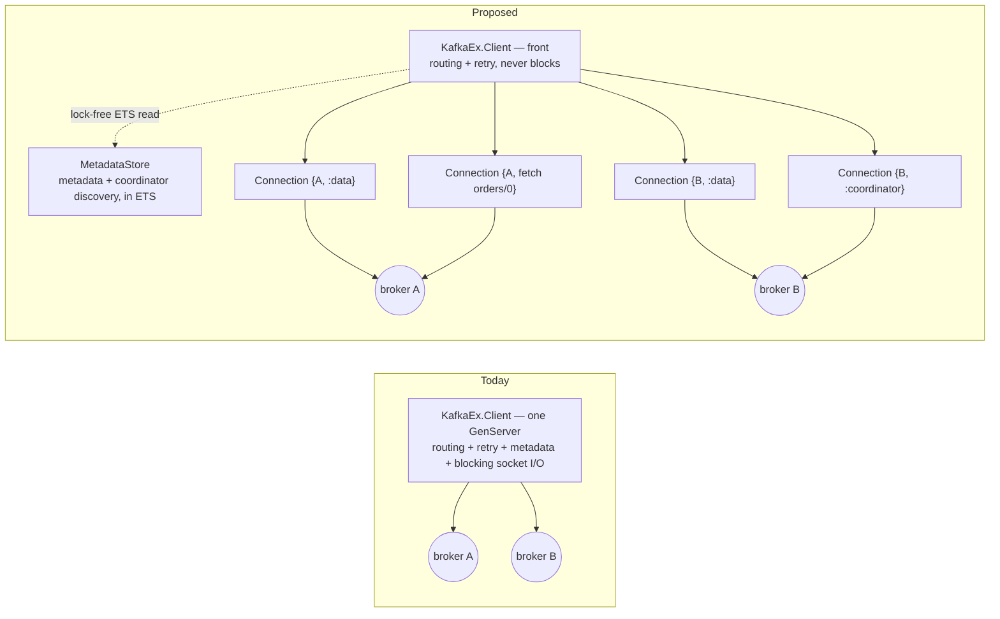
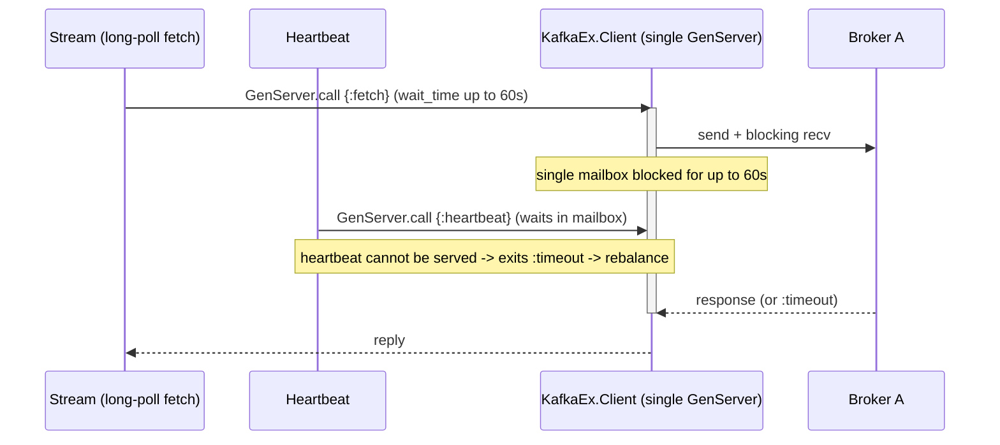
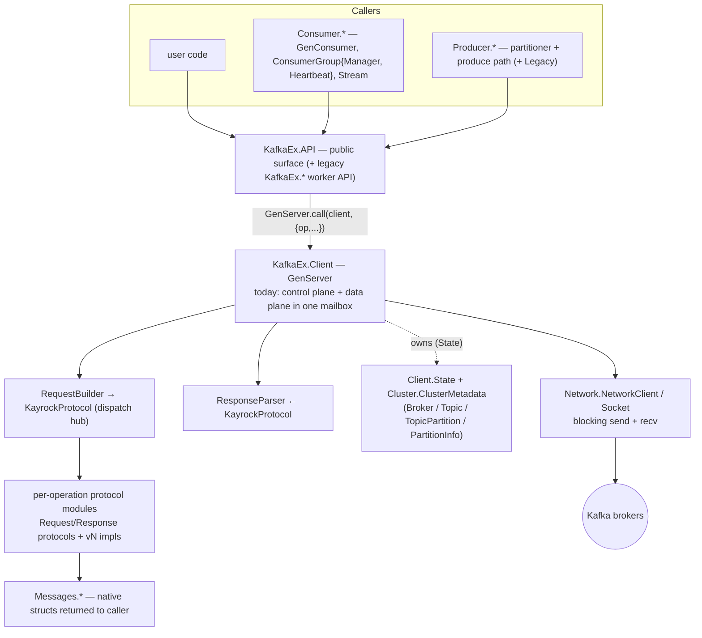
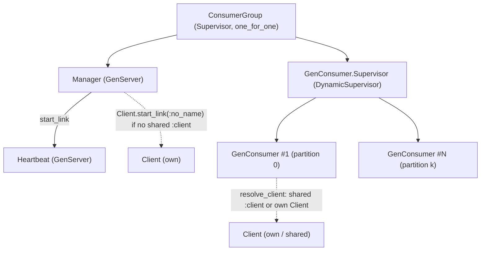
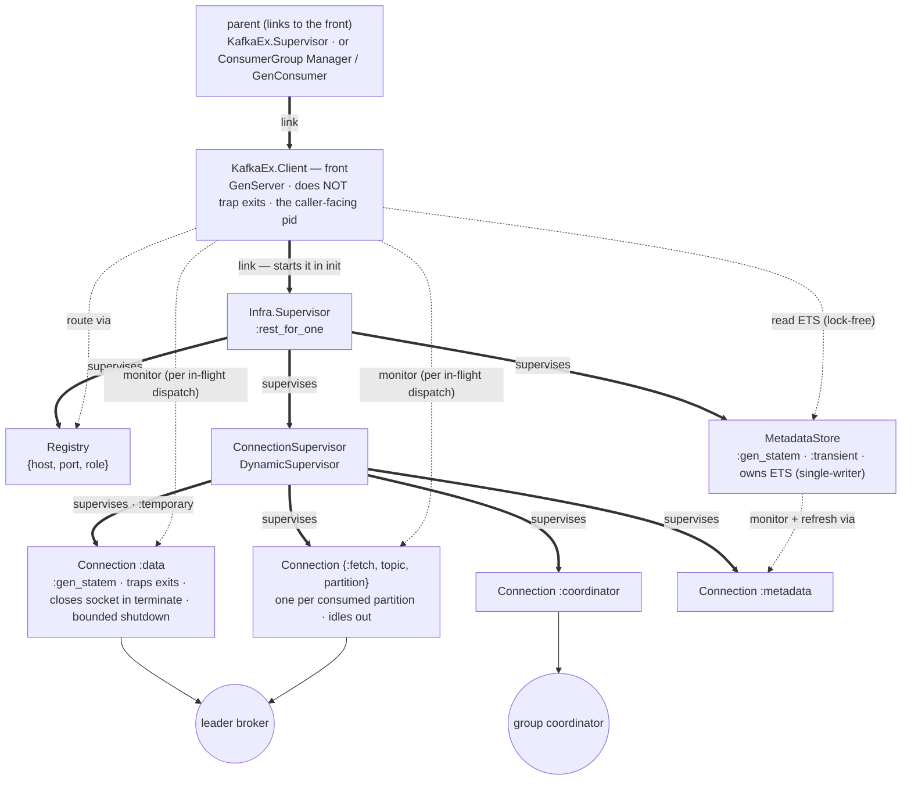
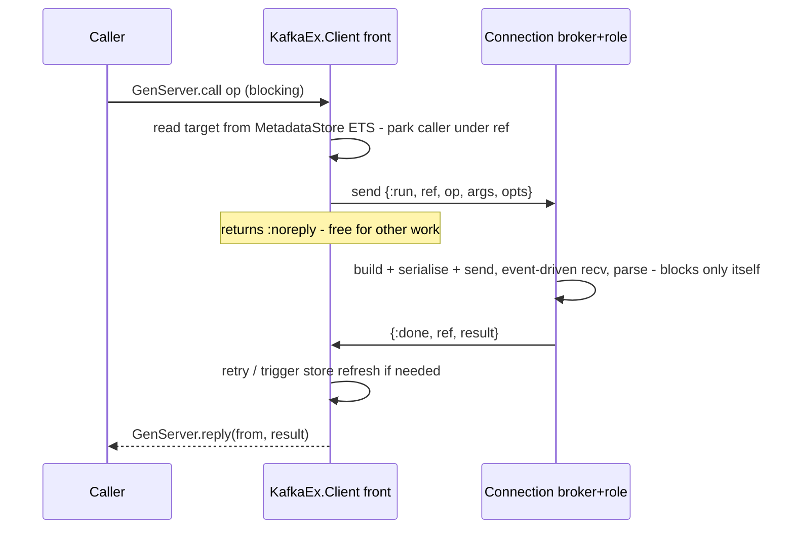
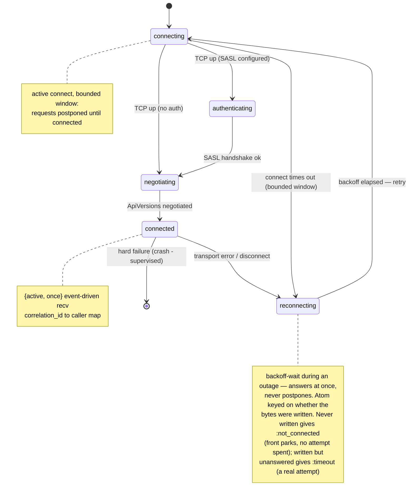
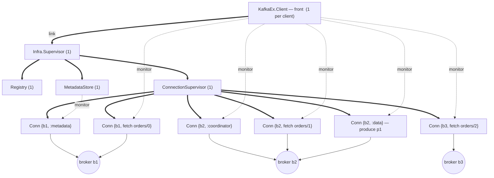
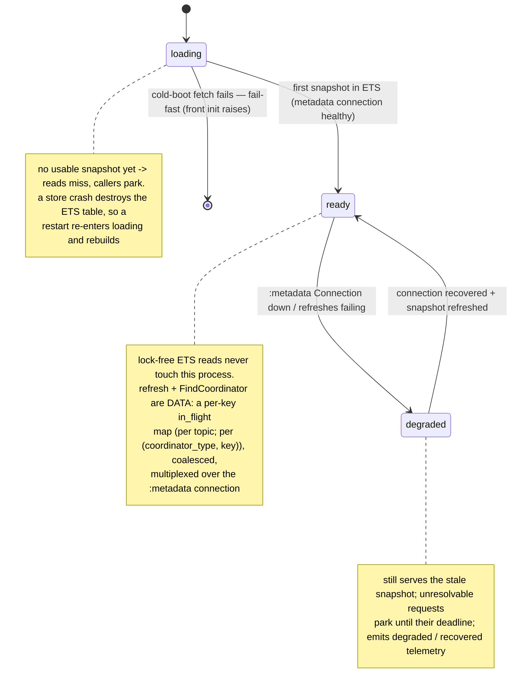
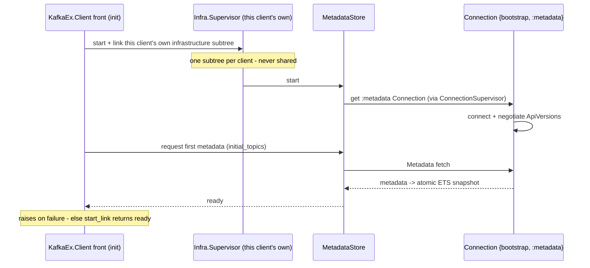

# RFC 0001: Non-blocking process architecture for `KafkaEx.Client`

- **Status:** Draft — request for comments
- **Author:** Argonus
- **Date:** 2026-07-28 (last updated 2026-09-27)
- **Target release:** v1.2.0, delivered incrementally; the public API's shape is unchanged throughout
- **Related issues:** #357 (`KafkaEx.stream` times out fetching at log-end), #445 (metadata cache not updated on produce)
- **Reviewers:** _(open — will be filled in as reviewers pick it up)_
- **Review deadline:** _(open — closes once discussion settles)_

## Contents

1. [Introduction](#1-introduction) — what we propose and what it costs
2. [Problem](#2-problem) — three failures, one root cause, and what "fixed" means
   - [Goals](#goals) · [Non-goals](#non-goals)
3. [What we have today](#3-what-we-have-today) — the code as it is
4. [Target architecture](#4-target-architecture) — the design, with a decision block (what / why / others / risk / trade-off) for every choice
   - [4.1 Overview and the contract with callers](#41-overview-and-the-contract-with-callers)
   - [4.2 The front: request lifecycle](#42-the-front-request-lifecycle)
   - [4.3 Connections: the data plane](#43-connections-the-data-plane)
   - [4.4 MetadataStore: metadata and coordinator discovery](#44-metadatastore-metadata-and-coordinator-discovery)
   - [4.5 Supervision, lifetime and boot](#45-supervision-lifetime-and-boot)
   - [4.6 How this compares to brod, the Java client and librdkafka](#46-how-this-compares-to-brod-the-java-client-and-librdkafka)
   - [4.7 Containing the risk: the rollback switch and how it lands](#47-containing-the-risk-the-rollback-switch-and-how-it-lands)
   - [4.8 What this leaves open](#48-what-this-leaves-open)

## 1. Introduction

`KafkaEx.Client` is one `GenServer` that does everything: it picks the broker, builds the request,
and then **blocks inside `handle_call`** waiting for the socket to answer. So one slow broker freezes
every caller of that client, whatever broker they wanted. That single fact is behind three real
failures: a long-poll fetch at the log end times out unrelated calls (#357), a metadata refresh races a
produce into stale leader data (#445), and one unresponsive broker can rebalance an entire consumer
group.

We propose to split that process into a small tree. The **front** (`KafkaEx.Client`, same name, same
pid callers hold today) only routes and retries. A per-client **`MetadataStore`** owns metadata and
coordinator discovery and serves reads from ETS. **`Connection`** processes each own one socket, are
event-driven, and block only themselves: one per broker and role, plus one per consumed partition
for fetch, so a long-poll never queues anything behind it. Every client owns its own tree; nothing
is shared between clients.

**What stays the same.** Every public function, option and return shape. `KafkaEx.Client` stays the
named process you call. Error atoms and telemetry event shapes stay as they are. No library consumer
has to change code; §4.1 lists the handful of semantics notes worth reading.

**What changes.** Two additive things: one config option (`request_concurrency`, the rollback switch)
and two telemetry events (`[:kafka_ex, :metadata_store, :degraded]` / `:recovered`). And two
behavioural changes, both on purpose. First, today's single mailbox happens to impose a **global
order** on requests from all callers; the new client orders requests only **per caller process**.
Second, a client whose periodic metadata refresh keeps failing today crashes
(`MetadataUpdateError`); the new client stays up in a `:degraded` state, serves its last snapshot,
and says so in telemetry. Three introspection functions keep their shapes but shift meaning
(`cluster_metadata/1`'s brokers no longer carry a socket, `correlation_id/1` counts admitted
requests, `api_versions/2` reports the metadata connection's negotiation); §4.1 has the details.

**What this costs.** The four things a reviewer is really being asked to accept:

1. **Request ordering weakens from global to per-caller.** Permanent. Two processes committing offsets
   for the same partition can now interleave. `GenConsumer` and `Stream` are unaffected because each
   blocks on its own commit; §4.1 explains why that invariant is load-bearing.
2. **Concurrency bugs replace blocking bugs.** A recursive, blocking retry loop becomes an async state
   machine. Failures that were obvious and reproducible become intermittent and load-dependent. This
   is the main correctness risk. §4.7 says how we contain it: one cutover PR, a config switch that
   reverses it in production, and tests aimed at interleavings.
3. **A per-request cost that did not exist before.** Every request now crosses a process boundary and
   reads its target out of ETS, which copies. Single-caller latency is expected to regress slightly;
   the 100-caller case is where the win has to show.
4. **Sockets scale with consumed partitions.** Each consumed partition fetches over its own
   connection, with its own handshake (D1). About even with today for an unshared consumer, more for
   a shared client consuming many partitions.

Before and after, in one picture:

If you only read one part, read the decision blocks in §4. They are what approval commits to.

## 2. Problem

**The root cause is structural.** `KafkaEx.Client` holds one `correlation_id` in `Client.State`
(bumped by `State.increment_correlation_id/1`), so it has **at most one request in flight** at any
moment. The request path `network_request/4` → `NetworkClient.send_sync_request/3` flips the socket to
`{active, false}` and blocks on `Socket.recv/3` **inside `handle_call`**. The periodic metadata refresh
(`:timer.send_interval` → `handle_info(:update_metadata)`) and the retry loop
(`handle_request_with_retry/4`, `refresh_for_error/3`) run in the **same mailbox**. One mailbox, one
blocking `recv`, one request at a time: a single slow broker freezes every caller of that client.

That shows up in three ways:

- **#357 — a long-poll fetch stalls everyone.** A `fetch` at the log end holds the `GenServer` for its
  full `wait_time` (up to ~60 s), so every other caller's `GenServer.call` times out.
- **#445 — metadata races produce.** Metadata reads and refresh queue behind slow socket I/O, so a
  produce can observe stale or mismatched topic metadata.
- **The black-holed-broker stall.** This one is not in the issue tracker, so this RFC is its written
  record. One broker that is "black-holed" (TCP up, no application reply) monopolises the client. The
  consumer group's `Heartbeat` call queues behind it and exits `:timeout`; the `Manager` rebalances; if
  the stall outlasts `session_timeout`, the coordinator evicts the member. **One unrelated broker
  triggers a group-wide rebalance.**

The v1.1.0 timeout changes (`request_timeout` 1 s → 15 s, `heartbeat_interval` 5 s → 3 s, fetch
transport `:timeout` retried ×3) made these windows longer, on top of the shared mailbox. Tuning
timeouts moves the failure window; it does not remove it.

None of the three clients we compare against later (brod, the Java client, librdkafka) fuse socket
I/O and metadata in one mailbox the way KafkaEx does today. See §4.6.

### Goals

In priority order, because they conflict at the margin. Each says how we will know it is met.

1. **One slow or unresponsive broker must not affect requests to any other broker.** This is the whole
   point. Met when a `fetch` with a long `wait_time` no longer delays an unrelated `metadata` call on
   the same client (a test). Also met when a broker that accepts TCP but never replies stops affecting
   other brokers while the group `Heartbeat` keeps being served (the chaos suite already has the fault
   injection for this). Also met when a produce to, or a fetch of another partition from, the same
   broker is not delayed by that long-poll. A fetch shares its socket only with other fetches of the
   same partition (D1); what still shares one is the short traffic on a broker's `:data` socket, such
   as produce and `list_offsets`, which the broker works through one at a time.
2. **Metadata must stay correct under load.** Reads never queue behind socket I/O, and a concurrent
   refresh cannot hand a produce a stale leader. Met when a produce can no longer observe a snapshot
   mid-replacement, which a test drives with a concurrent produce and refresh on one topic.
3. **Existing code must not change.** Every caller — `KafkaEx.API`, the legacy worker API,
   `ConsumerGroup.Manager`, `Heartbeat`, `GenConsumer`, `Stream` — keeps working untouched. Met when
   the compatibility contract in §4.1 holds item by item, with its two declared exceptions:
   per-caller ordering, and `:degraded` instead of a crash when refresh keeps failing.
4. **The change must be reversible in production without downgrading.** Met when
   `request_concurrency: :serial` passes the suite's ordering and behaviour tests that pin today's
   semantics (§4.7).

### Non-goals

Each of these is a plausible next step. Leaving them out is what keeps approval meaningful.

- **No breaking public API change.** Nothing is removed or renamed; the only additions are the rollback
  option and two telemetry events. An async request primitive, pause/resume, a rebalance listener —
  those are separate proposals (§4.8).
- **No producer or consumer process per partition** (brod's `brod_producer` / `brod_consumer`). A
  fetch *connection* per consumed partition is in (D1); the processes that drive it stay
  `GenConsumer` and `Stream`.
- **No cross-client sharing of metadata or connections** (D2).
- **No incremental fetch sessions (KIP-227), no idempotent or transactional producer, no cooperative
  rebalancing.** We must not foreclose them, which is cheaper than building them.
- **No performance tuning as a goal in itself.** Benchmarks exist to catch a regression, not to chase
  a number.

## 3. What we have today

**Layers, top to bottom.**

1. **`KafkaEx.API`** (`api.ex`) — the public surface. Every function takes `client` first and does
   `GenServer.call(client, {op, …}, budget)`, returning `{:ok, result}` / `{:error, reason}` with
   `result` a `Messages.*` struct. The legacy worker API (`kafka_ex.ex`: `create_worker`,
   `KafkaEx.Supervisor`) sits alongside it for backward compatibility.
2. **`KafkaEx.Client`** (`client/client.ex`) — the `GenServer` that owns a cluster connection. Its
   support cast in `client/`: `State`, `NodeSelector` (`:first_available` / `:topic_partition` /
   `:consumer_group`), `RequestBuilder` / `ResponseParser`, `RequestContext`, `RequestBudget`,
   `MetadataLog`; plus `Support.Retry` and `Telemetry` (the `[:kafka_ex, :request]` span).
3. **`Protocol.KayrockProtocol`** — the dispatch hub, and the only place the client talks to the
   protocol layer.
4. **Per-operation protocol modules** (`protocol/kayrock/<operation>/`) — `Request` / `Response`
   protocols with one `vN` impl per API version.
5. **`Network.NetworkClient` / `Network.Socket`** — stateless plumbing: `create_socket`,
   `send_sync_request` (the blocking `recv` this RFC targets), `close_socket`. `Network.Behaviour` is
   the Mimic seam.
6. **`Cluster.*` and `Messages.*`** — the broker / topic / partition model and the native result
   structs. `ClusterMetadata` also carries the coordinator cache and, today, live sockets in
   `Broker.socket`.

**Inside the client today.** The specifics this RFC changes:

- Sockets live in `Broker.socket`, inside `cluster_metadata`, inside `Client.State`. A metadata
  refresh rebuilds `ClusterMetadata` and has to transplant the live sockets into the new struct.
- `init/1` eagerly opens a socket to every bootstrap broker, and `update_metadata` opens one to every
  broker in the metadata (`maybe_connect_broker/2`), including brokers this client never talks to.
- One `correlation_id` for the whole client, and one set of ApiVersions negotiated at boot
  (`State.ingest_api_versions`) that every request is built against.
- Retry is a recursive loop (`handle_request_with_retry/4`) whose state lives on a blocking stack
  frame, with no delay between attempts other than the I/O itself. `Retry.with_retry/2` exists but
  sleeps, which is fine in a caller and fatal in a process that serves everyone.
- `KafkaEx.API` computes the caller's budget (`RequestBudget.call_budget/2`) but passes it only as the
  `GenServer.call` timeout. The server never sees it.
- `send_request/4` bypasses the retry loop entirely (`handle_call({:network_request, …}, …)`): send
  once, no retry. It is the documented escape hatch to the ~28 Kafka APIs Kayrock generates but
  `KafkaEx.API` does not wrap.
- `produce` with `acks: 0` is already special-cased: `network_request/4` sets `synchronous = false`
  when `acks == 0`, and `handle_produce_request/3` has a dedicated clause that never retries it.

**Who calls the client.** Everyone goes through `KafkaEx.API` → `GenServer.call`:
`ConsumerGroup.Manager` (join / sync / leave, offset fetch / commit), `ConsumerGroup.Heartbeat` (its
call is the one that exits `:timeout` in the black-holed-broker stall), `GenConsumer` (fetch, commit),
`Stream` (fetch; the long-poll at log-end is #357), `Producer.*`, and the legacy worker API.

In production the `Manager` **always** starts its own `Client` (its `:client` option is test-only
injection), and every `GenConsumer` starts its own unless handed a shared `:client`
(`resolve_client/3`, #581). So a group holds N clients: N metadata catalogs, N refresh loops, N socket
sets to the same brokers.

**How it is tested today.** Unit tests stub `NetworkClient` with Mimic in private mode (stubs bound
to the calling process) and, in eight files, call `Client.handle_call/3` **directly**: 28 assertions
on its synchronous return value. `test/kafka_ex/client/transport_error_test.exs` already flags the
exposure ("the request runs in THIS process … a future refactor to a real GenServer would need
`set_mimic_global`"). The integration suite runs against the Docker 3-broker cluster;
`integration-tests.yml` and `chaos-tests.yml` retry failed tests twice. There is no benchmark
infrastructure: no `bench/`, no `benchee`.

## 4. Target architecture

The model is a **control plane / data plane** split:

- **Control plane** — the front `KafkaEx.Client` (routing + retry, one per user client) and its
  `MetadataStore` (metadata + coordinator discovery).
- **Data plane** — `Connection` processes: one per broker and role, plus one per consumed partition
  for fetch. Each owns exactly one socket and its own `correlation_id` space, is event-driven
  (`{active, once}`, never a blocking `recv`), and blocks only itself.

Infrastructure is **per client**. Two clients with identical credentials to the same cluster never
share a socket or a metadata refresh.

From a caller's perspective nothing changes. It still writes
`GenServer.call(client, {:fetch, topic, partition, offset, opts}, budget)`. Under the hood the front
reads the target from ETS, hands the request to the right `Connection` asynchronously, parks the
caller under a `ref`, and stays free to serve heartbeats, refreshes and requests to other brokers.

**What approval commits to.** The numbered decision blocks D1–D26 below are normative. The prose and
diagrams around them explain the mechanism so the design can be checked for soundness; they are not
commitments. Left to code review on purpose: the exact timer and backoff constants (connect window,
reconnect backoff, the liveness bound, the fetch-connection idle timeout, the retry budget) and the
ETS snapshot representation.

Edge styles in the diagram: thick `⇒` = link / supervision (lifetime-coupled), dotted `⇢` = monitor or
lock-free use (no lifetime coupling).

**Decisions at a glance.**

- [D1. Split per broker and per role, with a fetch connection per partition](#d1-split-per-broker-and-per-role-with-a-fetch-connection-per-partition)
- [D2. Infrastructure is per client, nothing is shared](#d2-infrastructure-is-per-client-nothing-is-shared)
- [D3. The front stays a plain GenServer and the pid callers hold](#d3-the-front-stays-a-plain-genserver-and-the-pid-callers-hold)
- [D4. Telemetry splits by what a span measures](#d4-telemetry-splits-by-what-a-span-measures)
- [D5. Retry lives in the front, a Connection is a dumb pipe](#d5-retry-lives-in-the-front-a-connection-is-a-dumb-pipe)
- [D6. Fresh ref per dispatch, separate attempt counter](#d6-fresh-ref-per-dispatch-separate-attempt-counter)
- [D7. The deadline travels with the request](#d7-the-deadline-travels-with-the-request)
- [D8. Monitor the caller, clean up on every terminal path](#d8-monitor-the-caller-clean-up-on-every-terminal-path)
- [D9. Per-partition produce gate in the front](#d9-per-partition-produce-gate-in-the-front)
- [D10. acks 0 completes on write and is never retried](#d10-acks-0-completes-on-write-and-is-never-retried)
- [D11. Retry decisions are a pure function](#d11-retry-decisions-are-a-pure-function)
- [D12. One multiplexed connection per node and role, not a pool](#d12-one-multiplexed-connection-per-node-and-role-not-a-pool)
- [D13. Four connection kinds: data, fetch, coordinator, metadata](#d13-four-connection-kinds-data-fetch-coordinator-metadata)
- [D14. A Connection is a state machine with real protocol states](#d14-a-connection-is-a-state-machine-with-real-protocol-states)
- [D15. The error atom says whether the bytes were written](#d15-the-error-atom-says-whether-the-bytes-were-written)
- [D16. Data connections are created lazily](#d16-data-connections-are-created-lazily)
- [D17. SASL fails closed, no credentials in state dumps](#d17-sasl-fails-closed-no-credentials-in-state-dumps)
- [D18. A Transport behaviour with an in-process fake](#d18-a-transport-behaviour-with-an-in-process-fake)
- [D19. One MetadataStore per client with lifecycle states](#d19-one-metadatastore-per-client-with-lifecycle-states)
- [D20. Refresh and discovery are coalesced per key](#d20-refresh-and-discovery-are-coalesced-per-key)
- [D21. The store owns its ETS table, no heir](#d21-the-store-owns-its-ets-table-no-heir)
- [D22. No new error atom](#d22-no-new-error-atom)
- [D23. The hot-path metadata read is narrow](#d23-the-hot-path-metadata-read-is-narrow)
- [D24. The front owns a linked Infra supervisor](#d24-the-front-owns-a-linked-infra-supervisor)
- [D25. Client boot is synchronous and fail-fast](#d25-client-boot-is-synchronous-and-fail-fast)
- [D26. The rollback switch is a cap, not a second path](#d26-the-rollback-switch-is-a-cap-not-a-second-path)

### 4.1 Overview and the contract with callers

The front is the process `start_link/2` returns and registers under `name`. Callers hold that pid and
`GenServer.call` it, exactly as today. It routes, retries and parks callers; it never does blocking
I/O. Everything else (`MetadataStore`, `Registry`, `ConnectionSupervisor`, the `Connection`s) is
internal and hangs off the front's own `Infra.Supervisor`.

**The compatibility contract.** These are invariants. Goal 3 is met when each of them holds.

- `KafkaEx.Client` remains the named front answering the same `GenServer.call({op, …})` messages.
  `start_link/2` still returns `{:ok, pid}`, registers `name`, and is ready on return. Every public
  function keeps its signature; an internal message may gain a field (the deadline, D7).
- No public function, option or return shape changes. Additive only: `request_concurrency` (D26) and
  the two `[:kafka_ex, :metadata_store, …]` events (D4).
- `send_request/4` keeps **send-once, no-retry**. Today its handler bypasses the retry loop; the front
  must exempt it from the uniform `{:done, …}` classification, or it silently gains retries: one
  `:timeout` today, up to three afterwards. Its explicit `timeout` becomes the entry's deadline (D7),
  and a `:first_available` selector keeps moving to the next candidate broker when one is not
  connected, as `first_broker_response/4` does today.
- `retry_count/0` and `coordinator_max_attempts/0` are unchanged. `@coordinator_max_attempts = 1`
  stays a structural cap on JoinGroup / SyncGroup, whatever the transport returns. Two things are not
  attempts: parking on a connection or a refresh (D15, D22), and the KIP-394 `member_id_required`
  re-issue, which is part of the join operation today and stays so.
- Every request keeps its own retry predicate from `RequestContext` (`data_plane_retryable?/1`,
  `fetch_retryable?/1`, `produce_retryable?/1`, `consumer_group_retryable?/1`,
  `join_group_retryable?/1`, `sync_group_retryable?/1`, `heartbeat_retryable?/1`,
  `commit_retryable?/1`), and `build_transport_error/1` keeps tagging transport failures as it does
  today.
- Error atoms are unchanged and none are added (D22). Callers see exactly today's: `:timeout` for a
  request that could not complete within its budget (a request parked to its deadline included),
  `:no_broker` when no target could be resolved, and the unchanged broker error codes.
  `:not_connected` is internal between `Connection` and front and no longer reaches a caller, because
  the front parks on it (D15).
- Explicit `metadata/2,3` and `topics_metadata/3` calls still refresh the cache and return the result:
  the front asks the store to refresh those topics, honouring the per-call
  `allow_auto_topic_creation`, and replies with the new snapshot. The `:update_metadata` call does the
  same; `:set_consumer_group_for_auto_commit` stays front state.
- Three introspection functions keep their shapes and shift meaning. `cluster_metadata/1` still
  returns `%ClusterMetadata{}` with `%Broker{}` structs of the same shape; `Broker.socket` stays as a
  field and is always `nil` after PR 1, so `Broker.connected?/1` and `has_socket?/1` return `false`
  (connection state is observable through the `:connection` telemetry events instead).
  `correlation_id/1` still returns an integer: the front's monotonic count of admitted requests,
  since wire correlation ids are per `Connection` now. `api_versions/2` returns the versions the
  client's `:metadata` connection negotiated; per-request `api_version` opts and the `:api_versions`
  config still take precedence, as today.
- Telemetry event names and measurements are unchanged. Transport events change emitting pid (D4),
  and event volume changes: fetch connections open lazily and close when idle, so `:connection` /
  `:connection.close` fire per consumed partition and on every idle close or leader move.
- The front stays the failure unit `ConsumerGroup` supervision monitors. `MetadataStore`,
  `Connection`, `Infra.Supervisor` and the `Registry` are never addressed by callers.
- Application boot and `disable_default_worker` are unchanged (D25).

**Declared change 1: ordering.** Today's single mailbox imposes a global total order on
requests from every caller. Nobody documented it, but it is real and it is relied on. The front
preserves order only **per caller process**; requests from different processes become genuinely
concurrent and may reach a broker in either order. Concretely: two processes committing offsets for
the same partition can now move the committed offset backwards and cause redelivery (at-least-once
still holds; nothing is lost). The common path is unaffected, because `GenConsumer` and `Stream` block
on their own commit (the private `commit/1` in `gen_consumer.ex`, reached from
`handle_commit(:sync_commit, …)`, and the private `commit_offset/2` in `stream.ex`), so at most one
commit per `(group, topic, partition)` is ever in flight.
**That is a load-bearing invariant of the consumer layer, not a coincidence.** Any future change that
stops the consumer blocking on its commit, an async API included, must supply an equivalent
guarantee. We deliberately add no commit-ordering gate: none of the three reference clients gates
commits (Java's consumer is single-threaded per instance; brod and librdkafka serialise through the
group coordinator). Direct callers of `commit_offset/5` are already warned in `usage-rules.md`.

**Declared change 2: a failing refresh degrades instead of crashing.** Today
`update_metadata_with_retry/2` raises `MetadataUpdateError` after three failed periodic refreshes,
the client crashes, and its supervisor restarts it, which loops for as long as the cluster stays
unreachable. The new store enters `:degraded` instead (D19): the client stays up, serves its last
snapshot, keeps retrying one level below with backoff, and marks the transition with
`[:kafka_ex, :metadata_store, :degraded]` / `:recovered`. Anyone who relied on the crash to notice
an unreachable cluster should watch those events.

#### D1. Split per broker and per role, with a fetch connection per partition

- **What:** the data plane is one `Connection` per `{host, port, role}`, where `role` is `:data`,
  `:coordinator`, `:metadata`, or `{:fetch, topic, partition}`. Every consumed partition fetches over
  its own connection to its leader, created on the first fetch and closed after an idle period
  without one. Produce and the other short requests share the broker's `:data` connection. No
  producer or consumer *process* per partition.
- **Why:** every failure in §2 is "one broker blocks everything", and the broker itself processes
  one request per connection at a time (it mutes the channel until the response has gone out).
  Isolating brokers and roles from each other removes the cross-broker failures. Giving each
  partition's long-poll its own socket removes the last place a 10 s wait could queue someone else:
  a produce, a `list_offsets`, or another partition's fetch to the same broker. Short requests can
  share a socket because nothing on it waits.
- **Others:** brod's default (`share_leader_conn: false`) gives each consumer and producer its own
  connection to the leader, for the same reason and with the same 10 s `max_wait_time`. Java and
  librdkafka keep one connection per broker but avoid the problem differently: one fetch per broker
  covering all its partitions, 500 ms waits, and separate producer and consumer instances with
  separate connections. KafkaEx fetches per partition with 10 s waits, so brod's answer is the one
  that fits. We do not copy brod's per-partition *producer* connection: a produce does not long-poll,
  and D9 orders it in the front.
- **Risk:** sockets per client grow from one per broker to roughly one per consumed partition plus
  one per `{broker, role}` in use: about even with today for an unshared `GenConsumer` client, more
  for a shared `:client` consuming many partitions, and a broker leading many of them sees that many
  connections from one client. Every fetch connection pays its own TCP / TLS, SASL and ApiVersions
  handshake, so authentication load on the client, the token provider and the broker scales with
  consumed partitions and with leader churn. And the connection is keyed per partition, not per
  caller: concurrent fetches of one partition within a client, or a fetch issued after an abandoned
  long-poll, still queue behind each other at the broker. The isolation is between partitions, not
  between callers of the same partition.
- **Trade-off:** KafkaEx moves from "one process does it all" to a small tree that scales with
  consumed partitions. We stop there: no per-partition processes, and a per-client store rather than
  per-partition state.

#### D2. Infrastructure is per client, nothing is shared

- **What:** each `KafkaEx.Client` owns its own `MetadataStore`, `Registry`, `ConnectionSupervisor` and
  connections under its own `Infra.Supervisor`. Auto-sharing between clients that happen to have the
  same `{bootstrap, ssl, auth}` identity is a future opt-in, not built here.
- **Why:** it keeps the trust boundary trivial: a socket authenticated with one client's SASL
  credentials can never carry another client's traffic. It keeps the blast radius per client. And it
  avoids a teardown / ref-counting question (who closes a shared subtree when the last front leaves?).
  The footprint sharing would save is already collapsible via a shared `:client` (§3).
- **Others:** Java and librdkafka are per instance; brod shares only through an explicitly named
  client. Same as all three.
- **Risk:** a consumer group keeps N stores, N refresh loops and N connection sets against the same
  brokers. The `Manager` always starts its own client and cannot share it; only `GenConsumer`s can,
  via `resolve_client/3` (#581).
- **Trade-off:** we pay the N-fold footprint to avoid enforcing a credential boundary on every socket
  and to keep failures isolated per client. Sharing can be added later without a breaking change.

#### D3. The front stays a plain GenServer and the pid callers hold

- **What:** `KafkaEx.Client` remains the process `start_link/2` returns and registers under `name`.
  It is a `GenServer`, not a `:gen_statem` and not a supervisor.
- **Why:** callers hold that pid and `GenServer.call` it, so it cannot be a supervisor. It multiplexes
  many in-flight requests, so per-request state has to live in a map keyed by `ref`, not in a single
  process state, which is what `:gen_statem` models. The `Connection` is the process with real states
  (D14).
- **Others:** no direct analogue; `brod_client` is the closest (a worker that owns its own
  sub-supervisors).
- **Risk:** a `GenServer` holding a `pending` map gets no framework help with per-entry lifecycle.
  Every terminal path has to be written by hand (D8).
- **Trade-off:** we give up `:gen_statem`'s `postpone` and state-enter conveniences in the front in
  exchange for a natural fit with N concurrent requests.

#### D4. Telemetry splits by what a span measures

- **What:** operation spans (`:produce` / `:fetch` / `:consumer.*`) stay in the front, same pid as
  today's client. The per-attempt `[:kafka_ex, :request]` span and the `:connection` / `:auth` /
  `:connection.close` events move to the `Connection`. Event names and measurements are unchanged; the
  `:auth` events carry exactly what they carry today, no more. Two new events:
  `[:kafka_ex, :metadata_store, :degraded]` and `:recovered`.
- **Why:** `[:kafka_ex, :request]` wraps one serialise → send → recv (bytes and broker), not the
  retried operation, so it belongs with the socket. Async emission means manual `:start` / `:stop`
  with stored timestamps instead of the synchronous `Telemetry.span/3` wrapper.
- **Others:** no analogue; an internal emission detail, not a protocol choice.
- **Risk:** the emitting pid of the transport events changes. Any test or handler that asserts on the
  emitter's pid breaks.
- **Trade-off:** same shapes, different emitter. A small compatibility wrinkle for a per-attempt
  measurement that is actually true.

### 4.2 The front: request lifecycle

The caller still makes a blocking `GenServer.call`. The front keeps every in-flight request in a
`pending` map keyed by `ref`. An entry holds the `from`, the request, its phase, the persistent
`attempt` counter (D6), a monitor on the caller (D8), the produce-gate slot if it holds one (D9), and
its absolute deadline (D7).

Phases:

- `:resolving` — pick the target from the store's ETS (lock-free): the partition leader for
  `:topic_partition` (a fetch goes to that partition's own connection, anything else to the leader's
  `:data` one, D1), the coordinator for `:consumer_group`, the controller for `:controller`, the
  named broker for `:node_id`, any broker in the snapshot for `:first_available` / `:random`. Hit:
  dispatch to the `(node, role)` `Connection` and move to `:in_flight`. Miss: cast "refresh X" to the
  store and park in `:awaiting_metadata` / `:awaiting_coordinator`.
- `:in_flight` — sent to a `Connection`; waiting for `{:done, ref, result}`.
- `:awaiting_metadata` / `:awaiting_coordinator` — waiting for the store's coalesced refresh to
  complete and notify; then back to `:resolving`.
- `:awaiting_connection` — the target `Connection` refused a request it never wrote
  (`{:error, :not_connected}`). Wait for it to report `:connected`, bounded by the deadline. A
  metadata epoch bump also wakes it back into `:resolving`, so an entry never stays bound to a broker
  that has stopped being the leader. This costs no retry attempt (D15).

On `{:done, ref, result}` the front runs today's classification, keyed **per request** exactly as
`RequestContext.retryable?` is today: data requests use `Retry.data_plane_retryable?/1`, produce
narrows to `Retry.produce_retryable?/1` (leadership errors only, never a transport timeout, so a
resend cannot duplicate records), and the consumer-group operations keep their own rule. Then:

| Result | The front | Budget |
|---|---|---|
| success | replies to the caller | – |
| leadership error | asks the store to refresh that topic, parks in `:awaiting_metadata` | −1 |
| coordinator error | asks the store to re-discover, parks in `:awaiting_coordinator` | −1 |
| transport timeout, coordinator request | replies the error at once (send-once) | – |
| transport timeout, predicate allows a retry | re-dispatches | −1 |
| `:not_connected` | parks in `:awaiting_connection` | untouched |
| not retryable for this request, or budget exhausted | replies the error | – |

The per-attempt timeout lives in the `Connection` (it holds the send timestamp) and reaches the front
as `{:done, ref, {:error, :timeout}}`; the retry decision stays in the front. Any wait in the front is
a timer plus a parked entry, never `Process.sleep`. Replying to a `from` whose caller already timed
out is a harmless no-op.

**Backpressure.** One blocking call per caller process bounds in-flight requests to the number of
calling processes, for *live* callers. Under caller churn, boundedness comes from the monitors and
deadlines in D8, not from the blocking contract. We state that as an invariant and defer an explicit
per-connection cap to the future async primitive that breaks the one-call-per-caller property (§4.8).

#### D5. Retry lives in the front, a Connection is a dumb pipe

- **What:** a `Connection` makes exactly one attempt and reports `{:done, ref, result}`. Dumb about
  retry, not about the codec: it builds, serialises and parses (§4.3). All retry
  classification (leadership error → refresh, coordinator error → re-discover, transport timeout →
  re-dispatch, budget exhausted → fail) happens in the front, with today's `Support.Retry` predicates
  and today's per-request `retryable?` rule from `RequestContext`, so produce still retries only
  leadership errors.
- **Why:** retry needs metadata (a new leader) and the caller's budget; the `Connection` has neither.
  Keeping it in one place also keeps `@coordinator_max_attempts` a structural cap on JoinGroup /
  SyncGroup.
- **Others:** same as all three (`brod_producer`, Java's `Sender` and coordinator, librdkafka's
  `rdkafka_request.c`; none retry inside the transport).
- **Risk:** the front becomes the single place where retry correctness lives. A bug there affects
  every request type.
- **Trade-off:** an extra message hop per attempt versus retry logic scattered across N connection
  processes. We take the hop.

#### D6. Fresh ref per dispatch, separate attempt counter

- **What:** `pending` is keyed by a fresh `ref` per physical dispatch, so a late `{:done, …}` from a
  superseded or timed-out attempt lands on no entry and is dropped. A separate `attempt` counter
  survives every retry and drives backoff, the retry budget and the telemetry attempt number.
- **Why:** the two have opposite lifetimes. The key dies with each attempt; the counter must not. One
  token cannot do both. The connection boundary reinforces it: a re-dispatch after a leadership change
  goes to a *different* `Connection` with its own `correlation_id` space.
- **Others:** same as all three (brod `corr_id` vs `failures`; Java `correlationId` vs
  `ProducerBatch.attempts`; librdkafka `rkbuf_corrid` vs `rkbuf_retries`).
- **Risk:** two identifiers per request is one more thing to get wrong when re-dispatching.
- **Trade-off:** slightly more bookkeeping for stale-reply safety without any global sequence.

#### D7. The deadline travels with the request

- **What:** `KafkaEx.API` already computes the caller's budget with `RequestBudget.call_budget/2`. It
  now also puts it in the request's existing `opts`; the front stores
  `deadline = monotonic_now + budget` on the entry and checks it before every dispatch. The budget is
  `per_attempt × attempts`, which sits inside `call_budget/2` by its 5 s buffer, so the front's reply
  always beats the caller's own `GenServer.call` timeout, as today; at the deadline the front replies
  `{:error, :timeout}`. The public `{op, …}` message tuples keep their shape, with the deadline riding
  in `opts`. The internal messages that have no `opts` (`send_request/4`'s `{:network_request, …}`,
  the legacy `{:offset, …}`) gain it as an extra element, and a message that arrives without one gets
  the front's default budget.
- **Why:** a `GenServer.call` timeout is caller-side only. A front that never sees the deadline cannot
  honour "no caller parked past its own deadline". Re-deriving it inside the front from
  `network_timeout` × `@retry_count` would be a second computation of one budget — the drift #562
  closed by making `@retry_count` the single source of truth — and wrong for `send_request/4`, where
  the caller passes an arbitrary timeout.
- **Others:** Java's documented `request.timeout.ms` bounds how long the client waits for the
  response to each request, and librdkafka's outbuf message timeout is per buffer. Both expire a
  request from its own clock, not from the caller's wait. Same idea.
- **Risk:** two clocks, the caller's `GenServer.call` timeout and the server-side deadline. They are
  computed from the same number; if someone ever changes one and not the other, the front gives up
  before or after the caller does.
- **Trade-off:** one extra key in `opts` for a promise we can actually keep.

#### D8. Monitor the caller, clean up on every terminal path

- **What:** on admission the front monitors the caller (its pid arrives free in `from`). An entry ends
  on exactly one of four terminal paths: reply to the caller, retry-budget exhaustion, deadline
  expiry, caller `:DOWN`. On each, the entry is dropped and the caller demonitored. Its produce-gate
  slot (D9) is released, waking the next FIFO waiter, as soon as no dispatch of that entry is still on
  the wire: at once if none is, otherwise when the in-flight dispatch reports back or its
  `Connection` dies, which the `Connection`'s per-attempt timeout bounds. A `Connection` `:DOWN` is
  **not** terminal: the front classifies every entry in flight on it as `{:error, :timeout}` (the
  crash may have come after a write, so the attempt is spent, the coordinator send-once rule applies,
  and each request's own predicate decides whether it is re-dispatched to a re-resolved target), and
  sends entries parked in `:awaiting_connection` for it back to `:resolving` at no cost.
- **Why:** this is the invariant the whole design leans on. An orphaned entry does not merely leak
  memory: at `N = 1` (D9) it holds a partition's only gate slot and stalls that partition silently and
  forever, which is exactly the failure class this RFC exists to remove. Holding the slot until the
  dispatch reports back keeps "at most N in flight per partition" true at the wire, which the future
  idempotent gate (`N ≤ 5`, §4.8) depends on. Monitor and deadline are complementary, not redundant.
  The monitor catches a caller killed by its own `GenServer.call` timeout, which is what happens to
  an ordinary process. The deadline catches one that survived by catching the exit, and also stops
  the front from *starting* an attempt that cannot finish in time. Treating a `Connection`
  crash as a failed attempt rather than a caller-visible failure matches today, where a socket
  `:closed` is retried on the data plane.
- **Others:** no analogue; this is the BEAM-specific part of the design.
- **Risk:** four paths plus the crash rule that must all release the same resources. Miss one and the
  failure is silent. That is why D11 wants the transition logic to be a pure function we can
  property-test.
- **Trade-off:** one monitor per in-flight request. Cheap on the BEAM, not free.

#### D9. Per-partition produce gate in the front

- **What:** the front admits at most N in-flight produce requests per partition. `N = 1` now (a
  mute); `N ≤ 5` later, gated by idempotent sequence numbers. A slot is held for the whole *logical*
  request across retries, not per dispatch, and released when the request has ended and nothing of
  it is still on the wire (D8). Waiters are FIFO.
- **Why:** the gate and retry must live in the same place, and retry is in the front (D5). Releasing
  per dispatch would let a second producer interleave *between* attempts, defeating the ordering the
  gate exists for. With the gate here, a `Connection` never serialises across partitions and a
  front-driven retry can never reorder a partition.
- **Others:** same as all three, and all three put it above the transport: brod
  `partition_onwire_limit` (default 1), Java mutes the partition at in-flight 1 or gates by idempotent
  sequence up to 5, librdkafka clamps to 5 under idempotence.
- **Risk:** `N = 1` caps produce throughput per partition per client at one request in flight. That
  is brod's default and what today's single-in-flight client already does.
- **Trade-off:** ordering by construction, for a throughput ceiling we already live under.

#### D10. acks 0 completes on write and is never retried

- **What:** for a request the broker will not answer (`produce` with `acks: 0`), the `Connection`
  replies `{:done, ref, :ok}` on a successful socket write, registers no `correlation_id` and arms no
  per-attempt timeout. The front replies success with no offset and never retries it. It is also the
  one request that does not park on `:not_connected` (D15): with nothing to retry and nothing to wait
  for, a fire-and-forget produce to a broker that is currently reconnecting fails at once, as today.
- **Why:** there is nothing to correlate and nothing to wait for. A front that waited would park the
  caller until its deadline and then report `{:error, :timeout}` for a send that succeeded, turning a
  working fire-and-forget produce into a reported failure. No retry, because a resend could duplicate
  records and no acknowledgement could ever say whether the first attempt landed: the reasoning
  already in `handle_produce_request/3`'s `acks: 0` clause.
- **Others:** the Kafka producer's documented `acks=0` semantics say the same: the record is added
  to the socket buffer and considered sent, with no wait for any acknowledgement.
- **Risk:** a write that succeeded into a socket buffer is not delivery. Same as today, and as every
  client's `acks: 0`.
- **Trade-off:** a dedicated path in the `Connection` (no correlation, no timer) for one request
  type, kept so that fire-and-forget stays exactly as cheap and as blind as it is today.

#### D11. Retry decisions are a pure function

- **What:** the front's decision logic is a pure `transition(entry, event) -> {entry', effects}`
  function with no processes, sockets or clock inside. The `handle_info` clauses only feed it events
  and execute the effects.
- **Why:** it keeps every retry decision in one readable place, and it is the precondition for
  property-testing the invariants that matter: every admitted entry reaches exactly one terminal
  path; no gate slot is ever leaked; the retry budget never goes negative; no entry replies twice.
  Those invariants are over *interleavings*, which example tests can only sample. If the logic were
  spread across `handle_info` clauses, a property test would need a live process and wall-clock time,
  would be slow and flaky, and should not be written.
- **Others:** no analogue; an implementation constraint, not a protocol choice.
- **Risk:** a discipline cost. Nothing stops a future patch from taking a shortcut inside a
  `handle_info`.
- **Trade-off:** a little indirection for a testable core. The `stream_data` dev dependency this
  enables is an open item in §4.7.

### 4.3 Connections: the data plane

A `Connection` is a `:gen_statem`, one per `{host, port, role}` within its client's subtree,
registered in the client's `Registry` (SSL and auth are implied by the owning client; for fetch the
role carries the partition, `{:fetch, topic, partition}`, D1). It owns one
socket in `{active, once}`, keeps a `correlation_id → caller` map so several requests can be in
flight at once, and reports each result to the front as `{:done, ref, result}`.

It also does all the protocol work for its socket. The front hands it `{op, args, opts}`; the
`Connection` builds the request with `RequestBuilder` at the versions *it* negotiated (per-request
`api_version` opts and the `:api_versions` config still win, as today), stamps its own
`correlation_id`, serialises, sends, deserialises and decompresses the reply and runs
`ResponseParser`. So the front receives `{:done, ref, {:ok, %Messages.*{}} | {:error, reason}}` and
never touches a payload, which is what keeps a large fetch from delaying heartbeats. The decode cost
stays in the `Connection` that received it; for a fetch that is the partition's own connection, so it
delays no other partition, produce or heartbeat (D1). `send_request/4` is the
pass-through: the `Connection` takes the prebuilt Kayrock struct, stamps its id, serialises, and
returns the deserialised response without `ResponseParser`, as today.

The diagram in §4 shows roles, not counts. Instantiated for a 3-broker cluster (`b1` / `b2` / `b3`),
one topic `orders` whose partitions `p0` / `p1` / `p2` lead on `b1` / `b2` / `b3`, a consumer group
whose coordinator is `b2`, and a client consuming all three partitions from committed offsets (so no
`list_offsets` is sent) and producing to `p1`:

The singletons (front, `Infra.Supervisor`, `Registry`, `MetadataStore`, `ConnectionSupervisor`) are
one each regardless of broker count; only `Connection`s scale: one per `{broker, role}` in use plus
one per consumed partition. One physical broker can back several sockets: here `b1` carries
`:metadata` and the fetch for `p0`, `b2` carries `:coordinator`, the fetch for `p1` and the `:data`
socket the produce uses. That separation is D13's payoff.

#### D12. One multiplexed connection per node and role, not a pool

- **What:** every request to a given broker and role goes over one socket, with multiple requests in
  flight matched by a `correlation_id → caller` map. There is no pool of interchangeable sockets per
  broker; a fetch connection is one socket for one partition, not a pool either. A per-request
  timeout fails only that request: the `Connection` keeps the socket open and
  keeps the abandoned `correlation_id` registered so the late reply is read off the socket and
  dropped (framing stays in sync; the front drops it anyway by fresh `ref`, D6). The socket is closed
  and reconnected only on a transport error, a TCP / SSL close, or a per-socket liveness bound:
  nothing received at all while requests are outstanding for longer than the largest expected wait
  among them (per-attempt timeout plus `max_wait_time`).
- **Why:** Kafka multiplexes over one TCP connection via `correlation_id` and orders per connection.
  A pool multiplies file descriptors and broker-side connections for no throughput gain, and splitting
  one partition's produces across sockets would break ordering. The timeout rule follows from
  sharing: today a recv timeout closes the socket, but on a shared socket a sibling's timeout can
  fire because a large response is queued ahead of it, and closing would turn one slow request into
  a failure for every sibling, and would fail a produce sibling outright since produce never retries
  `:timeout`.
- **Others:** same as all three for several requests in flight over one socket (brod
  `kpro_sent_reqs`, Java `InFlightRequests`, librdkafka `rkb_waitresps`). brod and librdkafka match
  responses by `correlation_id` as we do; Java keeps a FIFO deque per node and uses the
  `correlation_id` only as a sanity check, relying on Kafka's per-connection response order.
- **Risk:** the broker works through one socket serially, so on a `:data` socket a large response
  holds up its siblings (long-polls have their own sockets, D1). If that ever measures as the
  bottleneck, a small bounded `:data` pool (§4.8) is possible later, never splitting one partition
  across sockets.
- **Trade-off:** no pool on the `:data` socket and simpler ordering, for no parallelism for short
  requests to one broker beyond in-flight multiplexing; long-poll parallelism comes from the
  per-partition fetch connections (D1), not from a pool. We add no per-connection in-flight cap yet:
  we rely on the caller-blocking invariant
  stated under Backpressure in §4.2, and Java's `max.in.flight.requests.per.connection` (default 5)
  exists mainly to bound reordering under retry, which D9 already covers.

#### D13. Four connection kinds: data, fetch, coordinator, metadata

- **What:** the group coordinator gets its own connection, separate from data traffic even to the
  same physical broker. Metadata refresh and `FindCoordinator` go over a dedicated `:metadata`
  connection owned by the store. Each consumed partition fetches over its own connection (D1).
  Everything else, produce first of all, goes over the broker's `:data` connection.
- **Why:** the dedicated coordinator connection keeps `Heartbeat` from queueing behind produce and
  other `:data` traffic to the same broker, and, together with the per-partition fetch connection,
  removes the Heartbeat-vs-fetch coupling behind the black-holed-broker stall. The dedicated metadata
  connection keeps metadata correctness independent of the `:data` path. The per-partition fetch
  connection keeps a long-poll from queueing anything else.
- **Others:** coordinator on its own connection is in all three (brod says outright that the
  coordinator "has to be dedicated"; Java's `GroupCoordinatorNode` with the `+`-prefixed id;
  librdkafka's `rd_kafka_broker_add_logical`). A dedicated metadata connection is brod-only
  (`meta_conn`); Java and librdkafka fetch metadata over any node. A fetch connection per partition
  is brod's default too (D1). We follow brod on both because a socket is cheap on the BEAM.
- **Risk:** several sockets to one broker instead of one: `:data`, `:coordinator`, `:metadata`, and
  one per consumed partition it leads. On a large cluster with many clients that is more broker-side
  connections. And the broker processes requests on the `:coordinator`
  socket one at a time as well, so a JoinGroup or SyncGroup held for the rebalance timeout delays a
  heartbeat of *another* group served by the same client. Rare in practice, because the `Manager`
  always has its own client.
- **Trade-off:** more sockets for isolation between traffic classes. On the BEAM that is the cheap
  side of the trade.

#### D14. A Connection is a state machine with real protocol states

- **What:** states `:connecting → :authenticating → :negotiating → :connected`, plus `:reconnecting`
  (backoff after a drop). On a transient disconnect it fails its in-flight requests (replying to the
  front under D15's split), backs off and reconnects. Hard or unexpected failures crash and are handled
  by supervision. It never re-implements a supervisor.
- **Why:** connect, SASL and ApiVersions negotiation are real, ordered steps with different valid
  inputs, which is what a state machine is for. `postpone` handles "a request arrived during the
  handshake" without hand-rolled queueing.
- **Others:** mirrors librdkafka's per-broker state machine; Java's `NetworkClient` gates on
  `client.ready(node)`; brod's `kpro_connection` is a `proc_lib` process per socket holding zero
  Kafka business logic.
- **Risk:** more machinery than a socket call. SASL and ApiVersions move into the state machine, and a
  bug in reconnect handling can loop or leak.
- **Trade-off:** moving parts we did not have, for a connection that recovers on its own and never
  blocks anyone else.

#### D15. The error atom says whether the bytes were written

- **What:** while `:connecting` (a bounded window) a request is `postpone`d. While `:reconnecting`
  the `Connection` answers at once. Never written → `{:error, :not_connected}`: the front parks the
  entry until the connection reports `:connected` or the deadline hits, and spends **no** retry
  attempt. Written but unanswered → `{:error, :timeout}`: a real attempt, and the coordinator
  send-once rule applies.
- **Why:** "the broker never saw this" and "the broker may already have executed this" are different
  facts, and only the `Connection` knows which. Collapsing them into one retryable atom would do two
  kinds of silent damage: coordinator requests that are send-once today would get retried during
  exactly the outage window where today's client refuses, and three instant refusals could burn a
  caller's whole retry budget without one network attempt. Today's client is safe from the second only
  because blocking I/O spaces its retries; fail-fast removes that spacing, so we replace it with
  parking against a deadline. Answering immediately while reconnecting also keeps the mailbox bounded
  during an outage: the `Connection` never learns the caller's deadline, so it must not be the process
  that parks on it.
- **Others:** Java's `client.ready` gate plus connect timeout; librdkafka's outbuf message timeout.
  Same shape: the transport refuses fast, the layer above decides how long to wait.
- **Risk:** a third failure shape for the front to handle (`:awaiting_connection`), and one more place
  where "did we spend an attempt?" has to be right.
- **Trade-off:** one more atom the front must route, for a retry budget that means "network attempts"
  and a send-once rule that stays bit-for-bit.

#### D16. Data connections are created lazily

- **What:** at boot the store opens only its `:metadata` connection (needed for fail-fast). A
  `{broker, :data}` or `:coordinator` connection is created on the first request routed to it, through
  the `ConnectionSupervisor`, and registered in the `Registry`. A `{:fetch, topic, partition}`
  connection is created on the first fetch for that partition and stops itself after an idle period
  without one (the constant is left to code review; longer than the largest `max_wait_time`, and the
  idle clock does not run while a request is outstanding), so a consumer that stops leaves no socket
  behind. An idle stop that races a dispatch costs no attempt: the connection first unregisters from
  the `Registry`, then answers anything already in its mailbox with `{:error, :not_connected}`
  (D15), then exits `:normal`. A leader move is handled by routing, not by the connection: the
  in-flight fetch comes back with a leadership or transport error and takes §4.2's refresh row, the
  re-resolved fetch goes to a new `{new_leader, {:fetch, topic, partition}}` connection, and the old
  one sits idle until its timeout closes it. A dead `Connection` is recreated the same way, on
  demand. A `Connection` whose broker has disappeared from the metadata snapshot is
  stopped by the store's snapshot swap, as `merge_brokers` closes those sockets today, so nothing
  sits in `:reconnecting` for a broker that is gone.
- **Why:** today `init` opens a socket to every bootstrap broker and `update_metadata` to every broker
  in the metadata, including ones this client never talks to. Lazy connect stops that, and it means no
  reconnect storm after a crash.
- **Others:** same as all three.
- **Risk:** an unreachable data broker is discovered on first live use, not at boot. Today's eager
  connect surfaces it at start-up (or in the next refresh); with D16 plus fail-fast boot (D25), boot
  only proves the bootstrap broker.
- **Trade-off:** a cold first request per broker and role, and per consumed partition for fetch,
  repeated after an idle close or a leader move (connect + SASL + ApiVersions, during which the
  request is `postpone`d, D15), for fewer idle sockets.

#### D17. SASL fails closed, no credentials in state dumps

- **What:** a connection that has not completed `:authenticating` is not `:connected`, so nothing can
  be dispatched over it. `:plain_requires_tls` moves with the handshake, unchanged. Credentials are
  kept out of the `:gen_statem` state that `sys:get_state/1` and crash reports print. No new listener,
  port or secret-accepting option is added, and how SSL options are resolved does not change.
- **Why:** the handshake moves into a process whose state is printable by default, which the
  synchronous path did not expose in the same way.
- **Others:** no analogue needed.
- **Risk:** a crash report from a mis-scrubbed state could leak a secret. A review item on the
  `Connection` PR.
- **Trade-off:** credential scrubbing becomes a review obligation on every change to the
  `Connection`'s state, which the synchronous path never needed.

#### D18. A Transport behaviour with an in-process fake

- **What:** the event-driven `Connection` replaces the synchronous `NetworkClient.send_sync_request/3`
  seam the unit suite stubs. A `Transport` behaviour wraps `gen_tcp` / `ssl`; unit tests inject a fake
  that delivers the same hand-built wire bytes tests use today (e.g. `build_v0_metadata_response`) as
  `{:tcp, sock, data}` messages instead of a function return. The front is testable against a fake
  `Connection` replying `{:done, ref, result}`; the `Connection` against the fake `Transport`. A few
  fake-broker tests on a real loopback socket exercise framing and multiplexing; the Docker 3-broker
  suite stays the end-to-end gate.
- **Why:** `{active, once}` forces it, since bytes arrive as messages. The injected fake keeps tests
  `async: true` and deterministic. `set_mimic_global` would force `async: false` across the client
  suite and reintroduce cross-test interference: curing the symptom at the cost of the property that
  makes the suite trustworthy.
- **Others:** no analogue needed; this is a test seam.
- **Risk:** the 28 direct `handle_call/3` assertions across 8 files become rewrites against the async
  protocol, and they fall due at the `Connection` PR, the point where I/O first leaves the test
  process, not at the cutover. The ten `NetworkClient` stub sites (seven files) migrate onto the
  fake.
- **Trade-off:** a mechanical port of the existing stubs plus one new behaviour, for a suite that
  stays fast and parallel.

### 4.4 MetadataStore: metadata and coordinator discovery

The store is a `:gen_statem` whose three states are *lifecycle*, not refresh bookkeeping: `:loading`
(no usable snapshot yet), `:ready` (serving, cluster reachable), `:degraded` (serving a stale
snapshot, cluster currently unreachable). It owns the metadata ETS table, is its single writer, and
uses its own `:metadata` connection to refresh. Reads never enter any state and never touch its
mailbox; they hit ETS lock-free.

#### D19. One MetadataStore per client with lifecycle states

- **What:** states `:loading` / `:ready` / `:degraded`. Refresh and `FindCoordinator` are data (D20),
  not states. `:degraded` means the `:metadata` `Connection` is down (its own `:gen_statem` is already
  retrying with backoff one level below); the store keeps serving the stale snapshot and emits
  `[:kafka_ex, :metadata_store, :degraded]` / `:recovered` on the way in and out. Today the same
  condition crashes the client (declared change 2 in §4.1).
- **Why:** `:degraded` is a genuine behavioural mode (serve stale, bound refresh, tell the operator)
  and earns the state machine. A `:refreshing` state would force one global refresh at a time and
  serialise unrelated refreshes.
- **Others:** a metadata owner decoupled from connections is in all three (Java's shared `Metadata`,
  librdkafka's `rk_metadata_cache`, brod's `brod_client`), and all three model an in-flight refresh as
  data, not a state. Same.
- **Risk:** three lifecycle states plus a per-key map is more to reason about than "refresh when
  asked".
- **Trade-off:** an explicit degraded mode we can observe and bound, for a little state-machine
  ceremony.

#### D20. Refresh and discovery are coalesced per key

- **What:** a per-key `in_flight` map holds one coalescing entry per topic refresh and per
  `(coordinator_type, key)` discovery, each with its waiter set and an `epoch`. Concurrent triggers for
  the same key join the in-flight entry; different keys proceed in parallel over the one `:metadata`
  connection. On completion the store swaps the ETS snapshot atomically, bumps the epoch, and wakes
  the front. A parked front re-checks ETS after parking and the store always sends a wakeup, so a
  wakeup cannot be lost while the store is alive; a store restart is covered by the front re-issuing
  its parked triggers (D21).
- **Why:** this closes the #445 race (concurrent produces to a missing topic coalesce onto one refresh
  instead of racing) and de-storms coordinator re-discovery when a coordinator moves and `Manager`,
  `Heartbeat` and a commit all ask at once.
- **Others:** per-instance single-flight refresh is in all three (Java's `needFullUpdate` flags plus a
  version counter; librdkafka's `rd_kafka_metadata_cache_hint`; brod single-flights through its
  mailbox). Coalescing the in-flight `FindCoordinator` *per key* goes one step further than all three,
  which coalesce only per instance or dedup only the resolved result, not the in-flight lookup. It is
  cheap here because a waiter list is just a list.
- **Risk:** the epoch / re-check protocol is subtle. A missed wakeup parks a caller until its
  deadline.
- **Trade-off:** a small protocol between front and store, for refreshes that do not serialise behind
  each other.

#### D21. The store owns its ETS table, no heir

- **What:** a `:protected` table with the store as single writer and lock-free reads from the front.
  No `heir`. A store crash destroys the table (a BEAM table dies with its owner); the restarted store
  re-enters `:loading` and rebuilds. Meanwhile the front treats the table's absence as a miss (it
  checks `:ets.whereis/1` rather than letting `:ets.lookup/2` raise on a table that is gone), parks
  callers in `:awaiting_metadata`, and re-issues their refresh triggers once the restarted store
  reports `:ready`, because the old store's waiter sets died with it.
- **Why:** preserving the table across a crash needs another live process to hold it. That is
  machinery for a gap that is one metadata fetch, on one client.
- **Others:** no analogue; BEAM-specific.
- **Risk:** a brief park for every caller of that client while the store rebuilds.
- **Trade-off:** one metadata fetch of downtime per store crash, versus an heir process to keep alive.

#### D22. No new error atom

- **What:** while the store is `:degraded`, a request it cannot resolve parks in
  `:awaiting_metadata`, bounded by its deadline and spending no attempt; most requests still resolve
  from the stale snapshot. A caller whose request could never be resolved gets `{:error, :no_broker}`
  at the deadline: the atom today's `network_request/4` already returns when
  `get_send_request_function/4` cannot select a broker, and one `Retry.transient_error?/1` already
  classifies as retryable. The descriptive signal goes to telemetry (D19), not the return value.
- **Why:** every atom the front returns is one `KafkaEx.Support.Retry` already classifies. An unknown
  atom falls through `Retry.transient_error?/1` to `false`, so a new, more descriptive atom for the
  most transient condition there is would make the client give up on it permanently. Parking rather
  than failing fast is the same rule as D15's: `:no_broker` is transient, so an immediate answer would
  make the front re-dispatch at once and burn the whole retry budget with no spacing.
- **Others:** no analogue; the constraint comes from KafkaEx's own retry classifier.
- **Risk:** `:no_broker` is less descriptive than the situation deserves; operators read the
  telemetry, not the atom. And a request that cannot resolve waits for its deadline instead of
  failing at once.
- **Trade-off:** a less precise atom for retry behaviour that stays correct without touching the
  classifier.

#### D23. The hot-path metadata read is narrow

- **What:** the per-request lookup is keyed `{topic, partition}` and returns the minimal routing
  tuple. Nothing on the request path reads a whole topic's partition structure.
- **Why:** an ETS read copies the term out of the table. Today's lookup is a map read in the client's
  own state, with no copy. A narrow read keeps the new cost to a few words per request.
- **Others:** no analogue; an ETS-specific cost.
- **Risk:** this is the cost the single-caller benchmark measures (§4.7). A wide read would be a
  regression that did not exist before.
- **Trade-off:** a constrained ETS layout (its representation is left to code review) for a
  per-request copy that stays small.

### 4.5 Supervision, lifetime and boot

**Who owns what.** The front starts and links its own `Infra.Supervisor` in `init`. That supervisor
is `:rest_for_one` over, in order, the `Registry`, the `ConnectionSupervisor` (a `DynamicSupervisor`
of `:temporary` `Connection`s) and the `MetadataStore` (`:transient`). The front does not trap exits.
A `MetadataStore` or `Connection` crash is absorbed by a restart under `Infra.Supervisor` and reaches
the front only as a monitor `:DOWN`; the front dies only if `Infra.Supervisor` exhausts its restart
intensity, and then its parent recreates the whole client.

**Links, monitors, and who cleans up.** Three BEAM mechanisms, on purpose: supervision **links**
(shared lifetime), **monitors** (a one-way death signal, no lifetime coupling), and the **`Registry`**
(which monitors its registrants for us). There is no hand-rolled "live connections" table that could
drift from reality. Reading the edges as observer → observed:

| Observer → Observed | Mechanism | When the observed dies |
|---|---|---|
| `ConnectionSupervisor` → `Connection` | link, `:temporary`, bounded shutdown | not restarted; recreated lazily on the next request. On an ordered shutdown the `Connection` (which traps exits) closes its socket in its own `terminate/2` |
| `Registry` → `Connection` | Registry's built-in monitor | the `{host, port, role}` entry is auto-removed; a later lookup misses and the front asks `ConnectionSupervisor` for a fresh one |
| front → `Connection` | monitor | the front classifies every entry in flight on it as a failed attempt (`:timeout`) and re-resolves the ones still waiting for it (D8); the crash never takes the front down |
| `MetadataStore` → its `:metadata` `Connection` | monitor | a mid-refresh `:DOWN` fails the in-flight refresh; the store re-acquires the connection on the next one |
| front → `MetadataStore` | monitor + notify subscription | ETS reads miss; the front parks callers in `:awaiting_metadata` and re-resolves once the store is `:ready` |
| front → the caller | monitor per admitted request | the entry is dropped and everything it held is released, most importantly its produce-gate slot (D8) |
| front → `Infra.Supervisor` | link (started in `init`) | the front's death, for any reason, tears the subtree down in order; if `Infra.Supervisor` exhausts its restart intensity, the front dies with it and its parent recreates the client |
| `Infra.Supervisor` → its children (`:rest_for_one`) | link | a store restart rebuilds from bootstrap (the front parks and re-resolves); a `Registry` / `ConnectionSupervisor` restart also restarts the store (its dependant) and drops connection registrations, recreated lazily |

So the connection lifecycle is bookkept twice, both automatically: the `Registry` drops a dead
`Connection` from *routing*, and the front's monitor drops it from *in-flight accounting*. The front
holds exactly one link, to its `Infra.Supervisor`; everything else is a monitor. Teardown needs no
ref-counting, because the subtree has exactly one client; the only idle expiry is a `{:fetch, …}`
connection stopping itself (D16), a local `:normal` exit, not a negotiation.

**Blast radius.** A `Connection` crash is isolated: its front treats the entries in flight on it as
failed attempts (D8) and it is recreated lazily on the next request. A front crash affects only its own callers and its own
infrastructure. A `MetadataStore` crash restarts under its client's own supervisor, rebuilds its ETS
table, and parks that client's callers for one metadata fetch.

**Boot.** The OTP application boot is unchanged: `KafkaEx.start/2` starts `KafkaEx.Supervisor` (a
`DynamicSupervisor`) and, unless `disable_default_worker` is set, the default worker.
`disable_default_worker: true` boots the supervisor empty (no client, no store, no connection, no
socket to Kafka), which is what `mix test.unit` relies on. A client's boot is where the change is:

Every additional client (a group's `Manager` and each `GenConsumer`, absent a shared `:client`)
repeats this independently: its own store, its own negotiation, its own first fetch, its own
connection set. That is the deliberate cost of D2.

#### D24. The front owns a linked Infra supervisor

- **What:** the front starts and links `Infra.Supervisor` in `init` and does not trap exits.
  `Infra.Supervisor` is `:rest_for_one` with children in order `Registry` → `ConnectionSupervisor` →
  `MetadataStore`. `Connection`s are `:temporary` under a `DynamicSupervisor` with a bounded shutdown;
  the store is `:transient`, and the supervisor's restart intensity is tuned so transient store
  flapping self-heals rather than toppling the front. When the front stops, for any reason, the link
  tears the subtree down in order and each `Connection` closes its socket in its own `terminate/2`.
- **Why:** the front cannot be a supervisor (D3), but the subtree must live and die with it. A link
  does that with no ref-counting and no reliance on the front's `terminate/2` (which a non-trapping
  process skips on `:shutdown`). The child order matters under `:rest_for_one`: the `Registry` first so
  the others can register; the `ConnectionSupervisor` before the store because the store gets its
  `:metadata` connection through it, so a `ConnectionSupervisor` restart also restarts its dependant.
  The bounded shutdown keeps N parallel `:ssl.close/1` calls inside the caller's teardown budget.
- **Others:** `brod_client` is the closest precedent (a worker owning its sub-supervisors). The rest
  is plain OTP: a supervisor traps exits and treats an EXIT from its parent as a shutdown order
  whatever the reason, `:normal` included, so the link alone tears the subtree down; and a child that
  fails in `init` makes `Supervisor.start_link` return `{:error, …}` without the parent trapping
  exits.
- **Risk:** the child order is load-bearing; a reorder silently breaks restart semantics. A
  `Connection` that ignores its shutdown bound can hold up a teardown.
- **Trade-off:** one supervisor per client (more processes), for automatic, ordered cleanup with no
  hand-maintained table.

#### D25. Client boot is synchronous and fail-fast

- **What:** a client's `init` starts and links its `Infra.Supervisor`; the store obtains its
  `:metadata` `Connection` through the `ConnectionSupervisor`, negotiates ApiVersions and performs the
  first metadata fetch into ETS. `init` raises on any failure, so `start_link` returning means the
  client is ready. `initial_topics` warms that first fetch and forces no data connections. Application
  boot and `disable_default_worker` are untouched.
- **Why:** it preserves today's start / supervision contract (`Client.init/1` is synchronous and
  fail-fast now): an unreachable cluster at boot crashes for the parent to retry. A fail-fast infra
  child makes `Supervisor.start_link` return `{:error, …}` cleanly, without a race and without the
  front trapping exits.
- **Others:** no analogue cited. We keep today's fail-fast start because the supervision tree around
  KafkaEx relies on it.
- **Risk:** a slow bootstrap broker makes `start_link` slow, and a parent with a short start timeout
  may retry-loop. Same as today.
- **Trade-off:** boot-time coupling to the cluster, as today, for a `start_link` that means what it
  says.

### 4.6 How this compares to brod, the Java client and librdkafka

Read from each project's current `master` / `trunk`. Each row is one axis the design turns on; the
last column says whether we do the same and, if not, why.

| Axis | brod / kafka_protocol (Erlang) | Java client | librdkafka (C) | This RFC |
|---|---|---|---|---|
| Transport unit | `kpro_connection`, one `proc_lib` process per socket, `{active, once}` | one `NetworkClient` + `Selector` loop, not thread-per-connection | one thread per broker (`rd_kafka_broker_thread_main`) | **Same idea as brod / librdkafka:** one process per `{broker, role}` plus one per consumed partition for fetch, `{active, once}` (D1, D14) |
| Retry above the transport | `brod_producer` (`is_retriable/1`, `schedule_retry`) | `Sender` / coordinator, never `NetworkClient` | `rdkafka_request.c` (`ERR_ACTION_RETRY` / `REFRESH`) | **Same:** retry in the front, `Connection` is a dumb pipe (D5) |
| Multiple in-flight per connection | `kpro_sent_reqs` map by `correlation_id` | `InFlightRequests` per-node deque, `max.in.flight.requests.per.connection` = 5 | `rkb_waitresps` by `correlation_id`, `max.in.flight` = 1 000 000 (5 with idempotence) | **Same:** `correlation_id → caller` map; no explicit cap yet (D12) |
| Connection pool per broker | no | no | no | **Same:** no pool (D12) |
| Coordinator on its own connection | yes ("coordinator has to be dedicated") | yes (`GroupCoordinatorNode`, `+`-prefixed id) | yes (`rd_kafka_broker_add_logical`) | **Same** (D13) |
| Dedicated metadata connection | yes (`meta_conn`) | no, any node | no, any broker thread | **brod-style:** yes; sockets are cheap on the BEAM and it keeps metadata off the `:data` path (D13) |
| Metadata owner decoupled from connections | `brod_client`, lazy refresh single-flighted by the mailbox | shared `Metadata`, `needFullUpdate` + version counter | `rk_metadata_cache` + `rd_kafka_metadata_cache_hint` dedup | **Same:** `MetadataStore`, lock-free ETS reads (D19) |
| In-flight refresh modelled as | data | data | data | **Same;** and we also coalesce the in-flight `FindCoordinator` per key, which goes one step further (D20) |
| Produce in-flight per partition | `partition_onwire_limit` = 1 | mute at 1, or idempotent sequence gating ≤ 5 | clamped to 5 under idempotence | **Same:** `N = 1` gate in the front, `N ≤ 5` later with idempotence (D9) |
| Stale-reply key vs attempt counter | `corr_id` vs `failures` | `correlationId` vs `ProducerBatch.attempts` | `rkbuf_corrid` vs `rkbuf_retries` | **Same** (D6) |
| Connection per partition | yes by default (`share_leader_conn: false`) | no: one fetch per broker for all its partitions, 500 ms waits, separate producer and consumer instances | no: same approach as Java | **brod-style for fetch:** one connection per consumed partition; produce shares the broker's `:data` socket (D1) |
| Process per partition | yes (`brod_producer` / `brod_consumer`) | no | no | **Same as Java / librdkafka:** no; `GenConsumer` and `Stream` drive the fetch connections (D1) |
| Sharing across client instances | only via an explicitly named client | per instance | per instance | **Same:** per client; sharing is a future opt-in (D2) |
| Commit-ordering gate | no (serialised via the coordinator) | no (single-threaded consumer) | no (serialised via the coordinator) | **Same:** none; the consumer layer's blocking commit is the guarantee (§4.1) |

### 4.7 Containing the risk: the rollback switch and how it lands

The cost a reviewer is really accepting is "concurrency bugs replace blocking bugs" (§1). Three
things contain it: the cutover is one PR, a config switch reverses it in production, and the tests
are aimed at interleavings (D11, D18). Nothing in this subsection is a changelog or upgrade
commitment; it is how the design keeps its worst risk bounded.

#### D26. The rollback switch is a cap, not a second path

- **What:** `request_concurrency: :multiplexed` (default) `| :serial`. `:serial` caps simultaneously
  admitted `pending` entries at **one**. Same state machine, same retry classification, same
  telemetry; the front simply handles entries one at a time, so mailbox order becomes execution order
  and today's cross-caller ordering is restored: one request at a time, in the order they arrived.
  What still differs from today under `:serial`: metadata refresh runs in the store rather than in
  the front's mailbox, connections are lazy, and retries are spaced by timers rather than by blocking
  I/O. It is a client start option with an application-env default, read at boot; changing it means
  restarting the client. Entries waiting to be admitted sit in a FIFO in the front and are monitored
  and deadline-checked exactly like admitted ones. The option is temporary: removing `:serial` is a
  separate decision for maintainers once the multiplexed path has production mileage, not a date
  this RFC sets.
- **Why:** a minor release carrying a concurrency change needs an escape hatch that does not require a
  downgrade. A separate `:legacy` code path would be a third configuration nobody runs in production,
  and after PR 6 the old loop is dead code awaiting deletion in PR 7, not a supported configuration.
  The default is
  `:multiplexed` on purpose: a cautious `:serial` default would mean nobody exercises the new path, so
  its defects would surface only when the flag is removed. That defers the risk instead of reducing
  it, while withholding the fixes that motivate the work.
- **Others:** no analogue; a rollback switch is a release-safety device, not a protocol choice.
- **Risk:** `:serial` restores head-of-line blocking on purpose; a user choosing it knowingly trades
  back the #357 and black-holed-broker fixes. And it does **not** roll back the topology: sockets still
  live in `Connection`s and metadata in the store, so a defect introduced by the `Connection` or
  `MetadataStore` PR is not recoverable with this flag. For those, the rollback is a version pin to
  1.1.x.
- **Trade-off:** one temporary option to keep alive and test (Goal 4 is that `:serial` reproduces
  today's behaviour on the same suite), for a cutover that can be reversed in production with one
  config change.

**How it lands.** Seven PRs, individually releasable. The organising rule: **PRs 1–5 move
responsibilities between processes without changing observable behaviour; PR 6 is the single semantic
cutover.** Everything a reviewer must scrutinise for behaviour change, and everything a rollback would
have to undo, is concentrated in one place.

| # | PR | What moves | Observable change |
|---|---|---|---|
| 1 | Pure `Broker` + `Transport` seam | The socket leaves `%Broker{}` into a `node_id ⇒ connection` map; `Transport` behaviour + in-process fake (D18); benchmark baseline | `Broker.socket` always `nil` (§4.1). Refresh stops transplanting live sockets: a latent-bug fix, not a contract change |
| 2 | Selection + coordinator cache into `ClusterMetadata` | Leader / controller / coordinator selection and refresh-on-error move out of `Client` (`select_broker_with_update/3`, the `broker_for_*_with_update` helpers, `refresh_for_error/3`) behind a small interface | None; still in-process and synchronous |
| 3 | `Connection` as `:gen_statem` | One per `{host, port, role}` (fetch per partition, D1) under `ConnectionSupervisor` + `Registry`, both under `Infra.Supervisor`; sockets, SASL and ApiVersions negotiation move in. The client still calls it synchronously | None by contract. The largest step, and where the test migration falls due |
| 4 | `MetadataStore` as `:gen_statem` | ETS, the store's own `:metadata` connection, per-key coalesced refresh and `FindCoordinator`; the client reads ETS instead of holding `cluster_metadata` | Removes the #445 race on its own: the store is the single writer and swaps snapshots atomically, so a produce cannot see metadata mid-replacement |
| 5 | Telemetry split + deadline threading | Per-attempt and connection events move to the `Connection`; `KafkaEx.API` passes the budget it already computes into the request | Transport events change emitting pid. The deadline is unused until PR 6, which keeps this PR small |
| 6 | Cutover: the non-blocking front | `handle_call` returns `{:noreply, …}`; the `pending` map, deadlines, caller monitors, the produce gate, the retry state machine, `request_concurrency` | **The one semantic step.** Ordering becomes per-caller; #357 and the black-holed-broker stall end here |
| 7 | Cleanup | Delete the recursive synchronous retry loop and the now-dead `send_sync_request` paths | None |

The `Connection` (3) precedes the `MetadataStore` (4) even though the store closes #445 and would
show value sooner: the store owns a `:metadata` connection, so landing it first would mean building it
against the old connection shape and rebuilding it in step 3.

**The test suite's migration cost falls due at PR 3, not PR 6.** Mimic's private mode binds stubs to
the calling process, so stubs set in a test stop applying the moment the socket lives in a
`Connection`. The `NetworkClient` stub sites move onto the fake in PR 1, where it lands, so PR 3
does not break them; the direct `handle_call/3` tests (D18) are rewritten at PR 3 against the async
protocol. The answer is the injected fake, not `set_mimic_global`. For PRs touching the front,
CI's automatic retries **must be turned off**: they hide exactly the failure class this refactor
introduces (a genuine race looks like a flake and passes on the second attempt). During the cutover a
retry is evidence, not noise.

**Performance.** A benchmark suite lands in PR 1 and is re-run after PRs 3, 4 and 6: produce and fetch
throughput and p99 latency at 1, 10 and 100 concurrent callers. The two ends carry different burdens
of proof. The single-caller case is the one at risk (it pays the hop and the ETS copy and gains
nothing from multiplexing); the 100-caller case is where the win must appear. A regression at high
concurrency invalidates the premise and is a blocker, not a tuning task.

**Open for maintainers.** Two things this RFC does not decide unilaterally:

- Two dev-only dependencies: `stream_data` for property tests over the front's transition function
  (D11) and `benchee` for the baseline. Neither is added without sign-off.
- The single-caller latency threshold, which can only be set once PR 1's baseline exists. Naming a
  percentage now would be inventing one.

### 4.8 What this leaves open

Not built here, and not foreclosed. For each: what is already in place, and the one constraint to
respect so the door stays open.

- **Idempotent / transactional producer.** The wire layer exists (`transactional_id` on Produce
  V3–V8; `find_coordinator/3` already accepts `coordinator_type: :transaction`). The transaction
  coordinator is just another `:coordinator` connection resolved by the store (D13); D9's per-partition
  gate is exactly what idempotent produce needs; retry in the front (D5) is the one place
  re-sequencing on retry must happen. One multiplexed `:data` socket is fine: the broker tracks
  sequences per `producer_id`, so different producers' writes may interleave on the wire.
  **Constraint:** the transactional session (pid / epoch, per-partition sequence, added-partitions
  set, commit / abort state, epoch fencing) has a single owner per `transactional.id`, dispatches
  in order and gap-free per partition, and layers *above* the `Connection`. Connections stay dumb
  pipes; sequence state never scatters into them.
- **Broadway / GenStage.** A demand-driven producer needs a client that does not freeze on one fetch,
  which is precisely #357; this RFC unblocks it. KafkaEx has no async request primitive today and this
  RFC adds none. **Constraint:** the front's internal `{:done, ref, result}` path must keep a shape
  into which a future *additive* public async API (return a `ref`, later deliver
  `{:done, ref, result}`) can be layered without rearchitecting the front. That API is also where the
  one-call-per-caller backpressure stops holding, so it, not this RFC, is where a per-connection
  in-flight cap becomes necessary (D12).
- **Distributed Erlang.** All of a client's infrastructure (the `Registry`, the ETS table, the
  sockets) is node-local, which is the correct default: Kafka's own coordinator handles membership
  across nodes, and routing Kafka traffic over Erlang distribution would be a bottleneck and a
  coupling. `:name` may still be `{:global, term}`, and a `GenServer.call` to it uses *that* node's
  local infra. **Constraint:** register a client's infra with a node-local name, never `:global`.
- **Cross-client sharing of metadata and connections.** A future opt-in keyed by
  `{sorted bootstrap uris, ssl_options, auth}`, subject to the same node-local constraint. Rejected as
  the default in D2.
- **A small per-broker `:data` pool.** Only if measurements ever show one multiplexed socket is the
  bottleneck, and never splitting one partition's produces across sockets (D12).
- **Multi-partition fetch and fetch sessions (KIP-227).** Both rely on one fetch per broker covering
  several partitions, which is not how D1 routes today. **Constraint:** the fetch role stays an
  opaque routing key chosen by the front, so a later `{:fetch, broker}` role covering several
  partitions changes only resolution, not the `Connection`.
- **Independent liveness detection** (TCP keepalive or a periodic probe). After this change the
  per-socket liveness bound in D12 is still the only detector of a silently hung broker; the
  architecture isolates the hang, it does not detect it faster.
- **Partition-count-change awareness and cooperative rebalancing**, which an actively refreshed store
  makes materially easier.

## References

- `lib/kafka_ex/client/client.ex`, `lib/kafka_ex/client/state.ex`,
  `lib/kafka_ex/network/network_client.ex`, `lib/kafka_ex/cluster/broker.ex`,
  `lib/kafka_ex/support/retry.ex`
- Issues #357, #445, #562, #581
- brod / kafka_protocol, the Apache Kafka Java client, and librdkafka, read from their current
  `master` / `trunk` for §4.6
